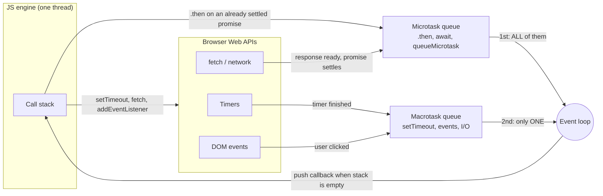
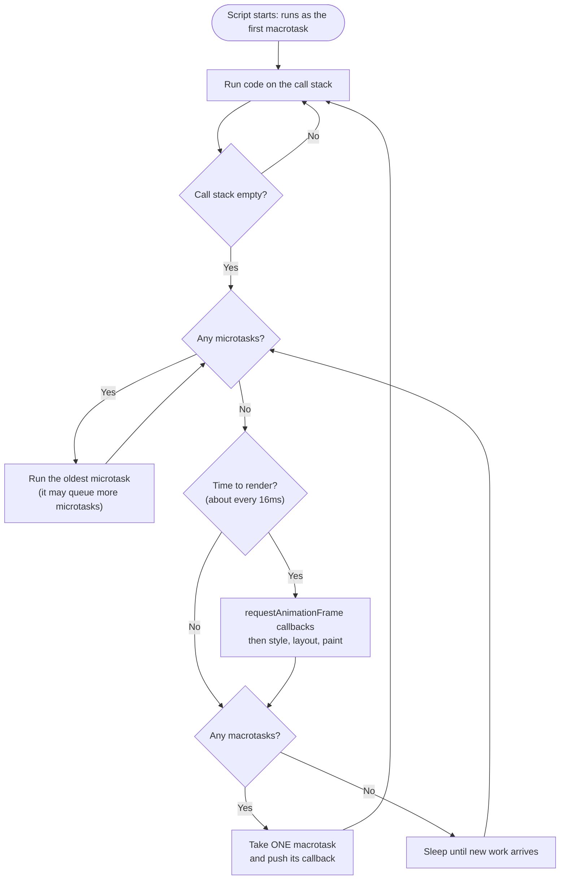
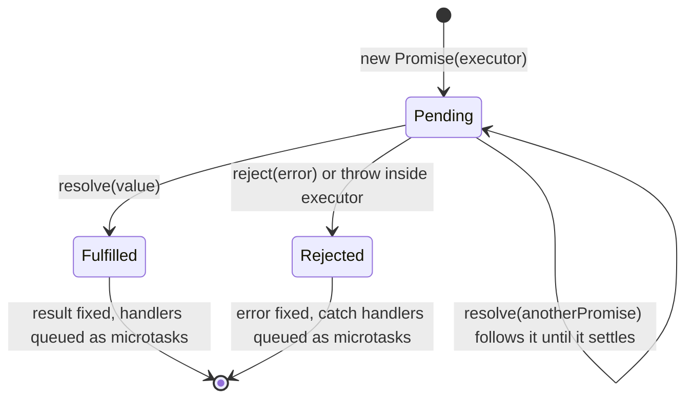
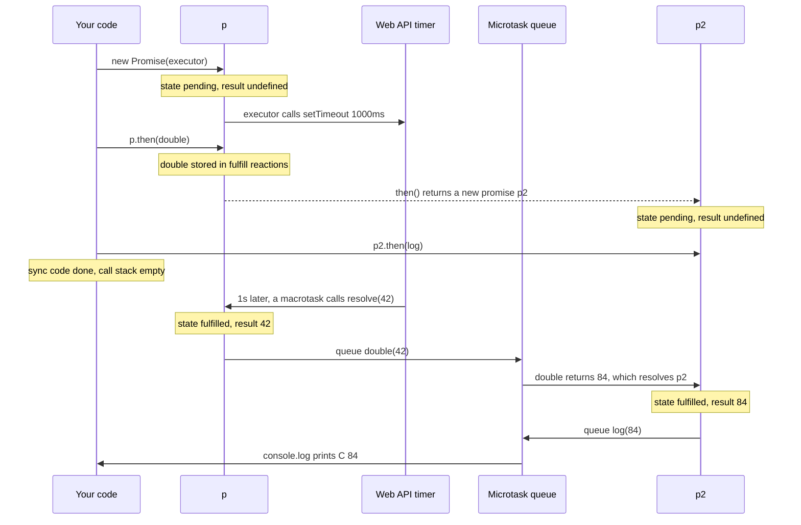

## 0. JavaScript fundamentals (asked before React)

Most React interviews open with 10–15 minutes of plain JavaScript. The favourites: the event loop, promises vs async/await, closures, `this`, and "what does this code print?" puzzles.

### Part A: Asynchronous JavaScript and the event loop

**JavaScript is single-threaded:** it can do one thing at a time. So how does it wait for a network request without freezing the page? It hands slow work to the browser (or Node), keeps running other code, and gets called back when the result is ready.

**The event loop in plain words.** There are four pieces:

1. **Call stack:** the function running right now. JS only works on what's on top of the stack.
   - When the program loads, the **Global Execution Context (GEC)** is pushed onto the stack first.
   - Each function call pushes a new frame on top; when the function finishes, it's popped off.
   - The GEC is the last thing to be popped.
2. **Web APIs:** the browser does slow work outside JS (timers, `fetch`, DOM events).
   - They give JS "superpowers": talking to servers, reading the location, changing the DOM, and so on. They are part of the **browser**, not the JS language, and act as an abstraction layer between JS and the browser/OS.
3. **Queues:** finished work (mostly work done by the Web APIs) waits here.
   - **Microtask queue (VIP line):** promise callbacks (`.then`, `await` continuation), `queueMicrotask`, `MutationObserver`.
   - **Macrotask / task queue (normal line):** `setTimeout`, `setInterval`, DOM events, I/O.
4. **Event loop:** it only acts when the call stack is empty. Then it runs **all** microtasks first, then the browser may render, then it takes **one** macrotask. Repeat.
   - After that single macrotask, the loop goes back to the start: check the stack is empty, drain **all** new microtasks, maybe render, pick **one** more macrotask, and so on forever.

**Where each piece of work goes:**



**One full turn of the loop:**



Because the "Any microtasks?" step loops until the queue is empty, a microtask that keeps queueing new microtasks never lets the loop reach rendering or macrotasks. That's why an endless chain of microtasks freezes the page.

**Common Web APIs:**

| Web API | What it does | Example methods |
| --- | --- | --- |
| DOM API | Changes HTML and CSS without a reload | `document.querySelector()`, `element.appendChild()` |
| Fetch API | Sends HTTP requests to servers | `fetch('https://example.com')` |
| Web Storage API | Saves data in the browser across refreshes | `localStorage.setItem()`, `sessionStorage.getItem()` |
| Geolocation API | Reads the device's GPS location | `navigator.geolocation.getCurrentPosition()` |
| Audio/Video APIs | Plays/records media, applies sound effects | `AudioContext`, `HTMLMediaElement` |

The key rule: **synchronous code first, then all microtasks, then one macrotask.** That's why a promise callback runs before a `setTimeout(fn, 0)`.

```js
console.log('1: sync');

setTimeout(() => console.log('2: timeout (macrotask)'), 0);

Promise.resolve().then(() => console.log('3: promise (microtask)'));

queueMicrotask(() => console.log('4: microtask'));

console.log('5: sync');

// Output: 1, 5, 3, 4, 2
```

`setTimeout(fn, 0)` means "at least 0 ms, after the current code and all microtasks", not "immediately". A long-running loop delays every timer.

**In Node.js** the order also includes `process.nextTick` (runs before promise microtasks) and `setImmediate` (the check phase, after I/O). Node's loop has phases: timers, pending callbacks, poll (I/O), check (`setImmediate`), close callbacks. The microtask queue (and `nextTick` queue) is drained between phases, and since Node 11 also after each individual timer/immediate callback. This "phases" model is **Node only**, not the browser.

### Callbacks

A callback is a function you pass to another function to be called later. The receiving function decides when to call it.

Callbacks are used both:

- **Asynchronously:** button clicks, `setTimeout`, network responses.
- **Synchronously:** `map`, `filter`, `forEach`, `sort` call your function right away.

```js
function getUser(id, callback) {
  setTimeout(() => callback(null, { id, name: 'Ann' }), 500);  // Node style: (error, result)
}

getUser(1, (err, user) => {
  if (err) return console.error(err);
  console.log(user.name);
});
```

**Problems with callbacks:**

- **Callback hell (pyramid of doom):** nested callbacks for steps that depend on each other. Hard to read and easy to get wrong.
- **Inversion of control:** you trust the other function to call your callback exactly once, with the right arguments. When you pass a callback into a third-party library (an analytics tracker, a payment plugin), you lose control over when or how your code runs. A buggy library might:
  - call your callback **twice** (e.g. charge a customer's card twice),
  - **never** call it (the user is stuck on a loading screen),
  - call it with the **wrong arguments**, breaking your app.
- **Error handling** has to be repeated at every level; `try/catch` doesn't catch errors thrown inside async callbacks. `try/catch` is synchronous: it has already finished by the time the async callback runs and throws, so nothing is there to catch the error. You have to pass errors along by hand (the `err` first argument).

```js
getUser(1, (err, user) => {
  getOrders(user.id, (err, orders) => {
    getOrderDetails(orders[0].id, (err, details) => {
      // deeper and deeper...
    });
  });
});
```

```js
try {
  setTimeout(() => { throw new Error('boom'); }, 0);
} catch (e) {
  console.log('never runs');   // try/catch finished long before the timer fired
}
```

### Promises

**A promise is an IOU for a future value.** It starts **pending**, then becomes **fulfilled** (with a value) or **rejected** (with an error). Once settled, it never changes.

Instead of passing a callback **into** an async operation (and losing control), the operation **returns** a placeholder object, the promise, that will hold the final result or error when it finishes.

```js
const wait = (ms) => new Promise((resolve, reject) => {
  if (ms < 0) reject(new Error('Negative time'));
  setTimeout(() => resolve(`Waited ${ms}ms`), ms);
});

wait(500)
  .then(msg => { console.log(msg); return wait(200); })   // return a promise to chain it
  .then(msg => console.log(msg))
  .catch(err => console.error(err))                       // catches errors from ANY step above
  .finally(() => console.log('done'));                    // runs either way
```

**What's inside a promise.** A promise is an object with hidden internal slots. DevTools shows some of them (`[[PromiseState]]`, `[[PromiseResult]]`), but your code can't read them directly; the only way to get the value is `.then` / `await`.

| Internal slot | What it holds |
| --- | --- |
| `[[PromiseState]]` | `"pending"`, `"fulfilled"` or `"rejected"` |
| `[[PromiseResult]]` | `undefined` while pending, then the value (fulfilled) or the error (rejected) |
| `[[PromiseFulfillReactions]]` | Handlers waiting for success (`.then(onFulfilled)`) |
| `[[PromiseRejectReactions]]` | Handlers waiting for failure (`.catch`, `.then(_, onRejected)`) |
| `[[PromiseIsHandled]]` | Whether any handler is attached; used for "unhandled rejection" warnings |

The executor receives a `resolve` / `reject` pair. They are the only way to change the state, and only the **first** call counts.

When the promise settles:

1. The state and result are set, once and for all.
2. Every waiting handler in the matching reaction list is queued as a **microtask**, and the lists are cleared.
3. If you call `.then` later on an already-settled promise, the handler is queued as a microtask straight away. It's still async, never synchronous.



**Watching the value change as code runs:**

```js
console.log('A');
const p = new Promise((resolve) => {
  console.log('B: executor runs now');
  setTimeout(() => resolve(42), 1000);
});
console.log(p);                        // Promise {<pending>}
const p2 = p.then(v => v * 2);         // stores a reaction on p; p2 is a NEW pending promise
p2.then(v => console.log('C:', v));    // stores a reaction on p2
console.log('D');

// A, B: executor runs now, Promise {<pending>}, D   ... 1 second later ...   C: 84
```



| Moment | `p` state | `p` result | `p2` state | `p2` result |
| --- | --- | --- | --- | --- |
| Sync code finished | pending | `undefined` | pending | `undefined` |
| 1000 ms: `resolve(42)` runs | **fulfilled** | **42** | pending | `undefined` |
| Microtask: `v => v * 2` runs | fulfilled | 42 | **fulfilled** | **84** |
| Microtask: `console.log` runs | fulfilled | 42 | fulfilled | 84 |

If the timer callback had called `reject(new Error('fail'))` instead, `p` would become `rejected` with that error. `p2` would also become `rejected` with the **same** error, because `v => v * 2` is skipped, and the next `.catch` would receive it.

**How promises fix each callback problem:**

**1. Callback hell → flat chains.**

```js
getUser(1)
  .then(user => getOrders(user.id))
  .then(orders => getOrderDetails(orders[0].id))
  .then(details => console.log(details))
  .catch(handleError);       // one place for all errors
```

**2. Inversion of control → you hold the promise.** The third-party code just hands you a promise object; **you** decide when and how to attach `.then()`. The engine also guarantees:

- A promise changes state only **once** (pending → fulfilled or rejected).
- Your handler is never called twice. If buggy code calls `resolve` several times, everything after the first call is ignored.
- A failure is delivered as an explicit rejection you can handle. (A promise *can* still stay pending forever if nobody resolves it; that's what timeouts with `Promise.race` are for.)

**Example: a third-party payment SDK.** You don't own this code and can't fix it:

```js
// Third-party SDK (imagine it's minified in node_modules)
const PaySDK = {
  charge(amount, onSuccess, onError) {
    // Bug: on a slow network it retries and calls onSuccess AGAIN
    // Bug: sometimes calls BOTH onSuccess and onError
    // Bug: if the server hangs, calls nothing at all
  },
};
```

**With callbacks, the SDK controls your code.** Whatever it does, your callback does too:

```js
PaySDK.charge(100, (receipt) => {
  saveOrder(receipt);          // could run twice -> duplicate orders
  sendConfirmationEmail();     // customer gets two emails
}, (err) => {
  showError(err);              // could ALSO run after a success
});
// If the SDK never calls back, the spinner spins forever.
```

**With a promise, control comes back to you.** Wrap the SDK once; the promise's rules protect everything after it:

```js
function chargeAsync(amount, ms = 10000) {
  const payment = new Promise((resolve, reject) => {
    PaySDK.charge(amount, resolve, reject);   // 2nd resolve, or reject after resolve: ignored
  });
  const timeout = new Promise((_, reject) =>
    setTimeout(() => reject(new Error('Payment timed out')), ms)   // fixes "never calls back"
  );
  return Promise.race([payment, timeout]);
}

async function checkout() {
  try {
    const receipt = await chargeAsync(100);
    if (!receipt?.id) throw new Error('Bad receipt from SDK');     // you still validate the data
    saveOrder(receipt);            // guaranteed to run at most once
    sendConfirmationEmail();
  } catch (err) {
    showError(err);                // runs only if the charge did NOT succeed
  }
}
```

| SDK bug | Callbacks | Promise wrapper |
| --- | --- | --- |
| Calls success twice | Your code runs twice | Second call ignored |
| Calls success **and** error | Both handlers run | Only the first one counts |
| Never calls back | Hangs forever | `Promise.race` timeout rejects |
| Passes wrong data | Breaks your app | **Not fixed:** still validate the value yourself |

Modern SDKs usually return a promise themselves (`const receipt = await sdk.charge(100)`), so you get these guarantees without writing the wrapper.

**3. Error handling → errors bubble down to `.catch`.** When something fails, the promise becomes rejected and holds the error. The rejection skips every `.then` below it until it reaches a `.catch`, so one `.catch` at the bottom handles an error from any step above.

```js
getUser(1)
  .then(user => getOrders(user.id))      // if this fails...
  .then(orders => getPayment(orders))    // ...or this fails...
  .catch(error => console.log('Caught any error that happened above!'));
```

**Things to know about `.then`:**

- `.then` always returns a **new** promise. That's what makes chaining possible. Whatever you return becomes the next value; return a promise and the chain waits for it.

  ```js
  fetch('/user')
    .then(response => response.json())          // returns a promise: the chain waits for it
    .then(user => {
      console.log(user.name);                   // the parsed object
      return 'Hello ' + user.name;              // a plain value
    })
    .then(greeting => console.log(greeting));   // "Hello Ann"
  ```

- Throwing inside `.then` rejects the next promise, which jumps to the nearest `.catch`. Every `.then` in between is skipped.

  ```js
  fetch('/profile')
    .then(res => {
      if (!res.ok) throw new Error('Profile not found!');   // jumps to .catch
      return res.json();
    })
    .then(data => console.log(data))                         // skipped
    .catch(err => console.error(err.message));               // "Profile not found!"
  ```

- Forgetting `return` inside `.then` breaks the chain: the next step gets `undefined` and doesn't wait. (A function with no `return` returns `undefined`.)

  ```js
  // Bug
  fetch('/user')
    .then(res => { res.json(); })        // forgot return
    .then(data => console.log(data));    // undefined, and it didn't wait for parsing
  ```

- The executor function in `new Promise(executor)` runs **synchronously**, right away. Wrapping code in `new Promise` does **not** make it async; only the `.then` callbacks run later (as microtasks).

```js
console.log('A');
new Promise(resolve => { console.log('B'); resolve(); }).then(() => console.log('D'));
console.log('C');
// A, B, C, D   <- B runs immediately; only .then is async
```

**Promise combinators (very common question):**

| Method | Resolves when | Rejects when | Use for |
| --- | --- | --- | --- |
| `Promise.all` | All fulfil (array of values, in order) | **Any** one rejects (fails fast) | Parallel requests that all must succeed |
| `Promise.allSettled` | All settle (array of `{status, value/reason}`) | Never | Parallel requests where some may fail |
| `Promise.race` | The **first** to settle fulfils | The first to settle rejects | Timeouts |
| `Promise.any` | The **first** to fulfil | All reject (`AggregateError`) | Fastest of several mirrors |

- **`Promise.all`: "all or nothing".** Returns an array of all values. If even one rejects, the whole thing rejects immediately with that error and the other results are thrown away. Best for: data the page can't work without (e.g. user profile **and** permissions).
- **`Promise.allSettled`: "the completionist".** Never short-circuits; waits for every promise and gives `{ status: 'fulfilled', value }` or `{ status: 'rejected', reason }` for each. Best for: independent jobs where one failure shouldn't cancel the rest (bulk emails, batch image uploads).
- **`Promise.race`: "the speed demon".** Settles with the result **or error** of whichever promise finishes first. Best for: timeouts (race a fetch against a 3-second timer).
- **`Promise.any`: "looking for a winner".** Ignores rejections and waits for the first **success**. Rejects with `AggregateError` only if every promise fails. Best for: redundant servers or mirrors; whichever responds successfully first wins.

```js
// Parallel: total time = slowest request, not the sum
const [user, posts] = await Promise.all([fetchUser(1), fetchPosts(1)]);

// Timeout with race
const timeout = (ms) => new Promise((_, reject) => setTimeout(() => reject(new Error('Timeout')), ms));
const data = await Promise.race([fetch('/api/slow'), timeout(3000)]);

// Some may fail
const results = await Promise.allSettled([fetchA(), fetchB()]);
results.forEach(r => r.status === 'fulfilled' ? console.log(r.value) : console.warn(r.reason));
```

**Same inputs, different combinators:**

```js
const p1 = fetch('/api/weather');          // fast success
const p2 = fetch('/api/news');             // slow success
const p3 = Promise.reject('Database Error'); // immediate failure

Promise.all([p1, p2, p3]).catch(err => console.log(err));
// rejects with 'Database Error'; p1 and p2 results are ignored

Promise.allSettled([p1, p2, p3]).then(results => console.log(results));
// waits for all three: two 'fulfilled' entries and one 'rejected'

Promise.any([p1, p2, p3]).then(first => console.log(first));
// ignores p3's failure, resolves with p1 (the first success)
```

**Turning a callback API into a promise ("promisify"):**

```js
function getUserAsync(id) {
  return new Promise((resolve, reject) => {
    getUser(id, (err, user) => (err ? reject(err) : resolve(user)));
  });
}
```

### async / await

**async/await is promise code written to look synchronous.** It's the same mechanism underneath.

- An `async` function **always returns a promise**. `return 5` becomes `Promise.resolve(5)`; throwing becomes a rejected promise.
- `await` pauses **only that function** until the promise settles; the rest of the program keeps running. The code after `await` resumes as a **microtask**.
- Use `try/catch` for errors.

```js
async function loadDashboard(userId) {
  try {
    const user = await getUser(userId);           // waits
    const orders = await getOrders(user.id);      // waits for the previous one (dependent)
    return { user, orders };
  } catch (err) {
    console.error('Failed:', err);
    throw err;                                     // re-throw so the caller knows
  } finally {
    hideSpinner();
  }
}

loadDashboard(1).then(data => console.log(data));  // it returns a promise
```

**Sequential vs parallel: the most common async/await mistake.**

- **Sequential:** put `await` in front of each call. The function stops on that line until it finishes, then starts the next. Use it when **task B needs data from task A** (you can't fetch a user's posts until you have the user's id).
- **Parallel:** start all the tasks **without** `await` (this fires the Web API work at once), then `await Promise.all([...])` on the bundle. Use it when the tasks are **independent** (sports scores and the weather forecast).

```js
// Slow: 2 seconds total (each await waits before the next starts)
const a = await fetchA();   // 1s
const b = await fetchB();   // 1s

// Fast: 1 second total (both start immediately, then wait together)
const [a2, b2] = await Promise.all([fetchA(), fetchB()]);

// Also parallel: start first, await later
const pA = fetchA(), pB = fetchB();
const a3 = await pA, b3 = await pB;
```

| | Sequential | Parallel |
| --- | --- | --- |
| Order | One after another | All at the same time |
| Total wait | Sum of all tasks (A + B) | The slowest task (max(A, B)) |
| Dependency | Fine when B needs A's result | Tasks must be independent |
| Syntax | `await` on every call | Start calls first, then `await Promise.all()` |

**await inside loops (the loop trap):**

- **`forEach` is broken for async:** it ignores the promises your callback returns. It starts every task at once but **doesn't wait**, so the code after the loop runs while the tasks are still going.
- **`for...of` is sequential:** `await` works properly; each item finishes before the next starts. Use it when order matters or to avoid hitting a database/API with 1,000 requests at once.
- **`map` + `Promise.all` is parallel:** `map` turns the array into an array of pending promises, and `Promise.all` waits for all of them.

```js
// Sequential (one after another): fine when order matters or to avoid hammering an API
for (const id of ids) {
  const user = await fetchUser(id);
}

// Parallel
const users = await Promise.all(ids.map(id => fetchUser(id)));

// Bug: forEach does NOT wait for async callbacks
ids.forEach(async id => { await fetchUser(id); });
console.log('done');   // logs before any fetch finishes
```

**How await works internally.** An `async` function is roughly a generator + promises. At each `await`, the function's state is saved and it returns to the caller. When the promise settles, the rest of the function is scheduled as a microtask.

```js
async function f() {
  console.log('2');
  await null;            // everything below becomes a microtask
  console.log('4');
}
console.log('1');
f();
console.log('3');
// 1, 2, 3, 4
```

**Callbacks vs promises vs async/await in one line each:**

- **Callbacks:** the simplest, but they nest badly and you can't `return` or `try/catch` across them.
- **Promises:** chainable values with one `.catch`, and combinators for parallel work.
- **async/await:** promise logic that reads top-to-bottom with normal `try/catch`. This is the default today.

**Cancelling async work: AbortController.**

```js
const controller = new AbortController();
fetch('/api/search?q=re', { signal: controller.signal })
  .catch(err => { if (err.name === 'AbortError') console.log('cancelled'); });
controller.abort();   // e.g. when the user types again or the component unmounts
```

### Async gotchas

- Unhandled rejections: a promise without `.catch` (or an un-awaited async call) fails silently in older code and crashes Node.
- `await` only works inside `async` functions (or at the top level of ES modules).
- `fetch` only rejects on network failure. Check `res.ok` for 404/500.
- `try/catch` around a promise you didn't `await` won't catch its error.
- `return await` inside `try` matters: without `await`, the `catch` in that function won't catch the rejection.
- An infinite chain of microtasks blocks rendering just like a `while(true)` loop.

### How JS runs code internally

- The environment a piece of code runs in is called an **execution context**. The global one (GEC) is created first; each function call creates its own.
- Every execution context is built in two phases:
  - **Creation (memory) phase:** memory is set aside for variables and functions (this is where **hoisting** happens: functions are stored whole, `var` is set to `undefined`, `let`/`const` exist but are in the temporal dead zone). The scope chain and `this` are also set up.
  - **Execution phase:** the code runs line by line, assigning values and calling functions.
- Each function call pushes a new execution context onto the **call stack**; when it returns, it's popped off.
- Infinite recursion fills the stack and gives "Maximum call stack size exceeded" (a stack overflow).

### Interview questions on this section

Try answering each one out loud before opening the answer.

**Concepts**

<details>
<summary>1. JavaScript is single-threaded. How can it do async work?</summary>

The JS engine has one call stack, so it runs one piece of code at a time. Slow work (timers, network, events) is handed to the browser's Web APIs (or Node's libuv), which run outside the JS thread. When that work finishes, its callback is put in a queue. The event loop pushes it onto the call stack once the stack is empty.

</details>

<details>
<summary>2. What is the event loop?</summary>

A loop that waits for the call stack to be empty. Then it runs **all** microtasks, lets the browser render if needed, and runs **one** macrotask. Then it repeats.

</details>

<details>
<summary>3. What's the difference between microtasks and macrotasks? Give examples.</summary>

- **Microtasks:** promise `.then`/`.catch`/`.finally`, code after `await`, `queueMicrotask`, `MutationObserver`. The whole queue is drained after every task, before rendering.
- **Macrotasks:** `setTimeout`, `setInterval`, DOM events, I/O, `MessageChannel`. Only one runs per loop turn.

So a resolved promise's callback always runs before a `setTimeout(fn, 0)` queued at the same time.

</details>

<details>
<summary>4. Does setTimeout(fn, 0) run immediately?</summary>

No. It runs at least 0 ms later, after the current synchronous code and all microtasks are done, and only when the loop reaches it in the macrotask queue. Browsers also clamp nested timers to about 4 ms. A busy main thread delays it further.

</details>

<details>
<summary>5. Can microtasks block rendering?</summary>

Yes. The loop drains the microtask queue completely before it renders. A microtask that keeps queueing new microtasks (for example, a recursive `Promise.resolve().then(loop)`) freezes the page just like `while (true)`. Recursive `setTimeout` doesn't freeze it, because rendering can happen between macrotasks.

</details>

<details>
<summary>6. What is inversion of control, and how do promises fix it?</summary>

When you pass a callback to someone else's code, they decide when, how often and with what arguments it runs. Buggy code could call it twice, never call it, or call both success and error. With promises, the other code returns a promise and **you** attach handlers. A promise settles only once, so extra `resolve`/`reject` calls are ignored and your handler runs at most once. Add a `Promise.race` timeout to handle "never calls back". Promises do **not** validate the data, so you still check that yourself.

</details>

<details>
<summary>7. Why doesn't try/catch catch an error thrown inside setTimeout?</summary>

`try/catch` only covers code that runs while the `try` block is on the call stack. The timer callback runs later, in a separate macrotask, after the `try/catch` has finished. Put the `try/catch` inside the callback, or use promises/`await` so the error comes back to you as a rejection.

</details>

<details>
<summary>8. What are the states of a promise? Can a fulfilled promise become rejected?</summary>

Pending, fulfilled or rejected. Fulfilled and rejected are both called "settled". Once settled, a promise never changes: further `resolve`/`reject` calls are ignored.

</details>

<details>
<summary>9. Is the code inside new Promise(...) asynchronous?</summary>

No. The executor runs synchronously, right away. Only the `.then`/`.catch` handlers run later, as microtasks.

</details>

<details>
<summary>10. What does .then return? What if the callback returns a promise?</summary>

`.then` always returns a **new** promise:

- If the callback returns a value, the new promise is fulfilled with it.
- If it throws, the new promise is rejected.
- If it returns a promise, the new promise waits for that one and takes its result.

That last rule is what makes flat chains possible.

</details>

<details>
<summary>11. Compare Promise.all, allSettled, race and any.</summary>

- **`all`:** fulfils with all values in order. Rejects as soon as one rejects.
- **`allSettled`:** waits for all of them and never rejects. You get `{status, value | reason}` for each.
- **`race`:** settles like the first promise to settle, success or failure. Use it for timeouts.
- **`any`:** fulfils with the first success. Rejects with `AggregateError` only if all fail.

</details>

<details>
<summary>12. Does await block the main thread?</summary>

No. It pauses only the current `async` function, which returns a pending promise to its caller. The rest of the program keeps running. When the awaited promise settles, the function resumes in a microtask.

</details>

<details>
<summary>13. What does an async function return?</summary>

Always a promise. `return x` fulfils it with `x` (or follows `x` if it's a promise). Throwing rejects it.

</details>

<details>
<summary>14. Why is using async callbacks with forEach a bug? What should you use?</summary>

`forEach` ignores the promises your callback returns, so the code after the loop runs before the work is done. Errors also go unhandled. Use `for...of` with `await` to run them one after another, or `await Promise.all(arr.map(fn))` to run them in parallel.

</details>

<details>
<summary>15. How do you run two independent requests in parallel with async/await?</summary>

Start both before awaiting: `const [a, b] = await Promise.all([fetchA(), fetchB()])`. Writing `await fetchA(); await fetchB();` runs them one after another, so the total time is the sum of both instead of the slower one.

</details>

<details>
<summary>16. Does fetch reject on a 404 or 500?</summary>

No. It only rejects on network failure or when aborted. Check `res.ok` (or `res.status`) and throw yourself.

</details>

<details>
<summary>17. Why does return await matter inside try/catch?</summary>

`return promise` inside `try` hands the promise straight back to the caller. If it rejects later, this function's `catch` never sees the error. `return await promise` waits inside the `try`, so the `catch` (and `finally`) handle it.

</details>

<details>
<summary>18. In Node, what's the order of process.nextTick, promises, setTimeout and setImmediate?</summary>

`process.nextTick` callbacks run first, then promise microtasks. After that it depends on the event loop phase: `setTimeout` callbacks run in the timers phase and `setImmediate` callbacks in the check phase. From the main script, the order of `setTimeout(fn, 0)` vs `setImmediate` isn't guaranteed. Inside an I/O callback, `setImmediate` always runs first.

</details>

**What does this print?**

<details>
<summary>19. Promise, async and setTimeout mixed together</summary>

```js
console.log('start');
setTimeout(() => console.log('timeout'), 0);
Promise.resolve()
  .then(() => console.log('p1'))
  .then(() => console.log('p2'));
(async () => {
  console.log('async start');
  await null;
  console.log('async end');
})();
console.log('end');
```

**Answer:** `start, async start, end, p1, async end, p2, timeout`

- The sync code runs first. `async start` is sync because an async function runs synchronously up to its first `await`.
- Microtask queue at that point: `p1`, then `async end`. `p2` is only queued once `p1` has run.
- `timeout` is a macrotask, so it runs last.

</details>

<details>
<summary>20. Microtasks inside macrotasks</summary>

```js
setTimeout(() => {
  console.log('t1');
  Promise.resolve().then(() => console.log('p-inside-t1'));
}, 0);
setTimeout(() => console.log('t2'), 0);
Promise.resolve().then(() => {
  console.log('p1');
  setTimeout(() => console.log('t-inside-p1'), 0);
});
```

**Answer:** `p1, t1, p-inside-t1, t2, t-inside-p1`

All microtasks are drained after **each** macrotask. So `p-inside-t1` runs before `t2`. `t-inside-p1` was queued last, so it runs last.

</details>

<details>
<summary>21. Calling resolve twice, and throwing after resolve</summary>

```js
const p = new Promise((resolve, reject) => {
  resolve('first');
  resolve('second');
  reject(new Error('oops'));
  throw new Error('thrown');
});
p.then(v => console.log('ok', v)).catch(e => console.log('err', e.message));
```

**Answer:** `ok first`. The promise settles on the first `resolve`, and everything after that is ignored, including the `throw`.

</details>

<details>
<summary>22. Forgetting to return inside .then</summary>

```js
Promise.resolve(1)
  .then(x => { x + 1; })
  .then(x => console.log(x));
```

**Answer:** `undefined`. The arrow function has a block body with no `return`.

</details>

<details>
<summary>23. .catch in the middle of a chain</summary>

```js
Promise.reject(new Error('A'))
  .then(() => console.log('then 1'))
  .catch(e => { console.log('caught', e.message); return 'recovered'; })
  .then(v => console.log('then 2', v));
```

**Answer:** `caught A`, then `then 2 recovered`. The rejection skips `then 1`. A `.catch` that returns normally turns the chain back into a fulfilled one.

</details>

**Write the code**

<details>
<summary>24. Implement Promise.all</summary>

```js
function promiseAll(iterable) {
  return new Promise((resolve, reject) => {
    const items = Array.from(iterable);
    const results = new Array(items.length);
    let remaining = items.length;
    if (remaining === 0) return resolve(results);

    items.forEach((item, i) => {
      Promise.resolve(item).then((value) => {   // also accepts plain values
        results[i] = value;                     // keep the original order
        if (--remaining === 0) resolve(results);
      }, reject);                               // the first rejection wins
    });
  });
}
```

Key points: keep results in input order (not finish order), accept non-promise values, reject on the first failure, and resolve immediately for an empty input.

</details>

<details>
<summary>25. Write sleep(ms) and a withTimeout(promise, ms) helper</summary>

```js
const sleep = (ms) => new Promise((resolve) => setTimeout(resolve, ms));

function withTimeout(promise, ms) {
  let id;
  const timeout = new Promise((_, reject) => {
    id = setTimeout(() => reject(new Error(`Timed out after ${ms}ms`)), ms);
  });
  return Promise.race([promise, timeout]).finally(() => clearTimeout(id));
}

await sleep(500);
const data = await withTimeout(fetch('/api'), 3000);
```

Clearing the timer in `finally` stops a leftover timer from firing after the real promise has already won.

</details>

<details>
<summary>26. Promisify a Node-style callback function</summary>

```js
function promisify(fn) {
  return (...args) =>
    new Promise((resolve, reject) => {
      fn(...args, (err, result) => (err ? reject(err) : resolve(result)));
    });
}

const getUserAsync = promisify(getUser);
const user = await getUserAsync(1);
```

Node ships this as `util.promisify`.

</details>

<details>
<summary>27. Retry an async function up to n times</summary>

```js
async function retry(fn, retries = 3, delay = 500) {
  for (let attempt = 1; ; attempt++) {
    try {
      return await fn();                       // return await, so the catch below sees failures
    } catch (err) {
      if (attempt >= retries) throw err;
      await sleep(delay * attempt);            // simple backoff
    }
  }
}
```

</details>
