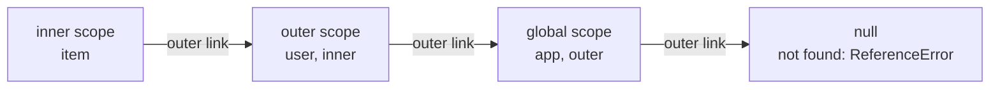
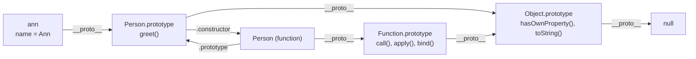

# Part B: How JavaScript works internally

**How code runs: execution context in two phases.** Before running any function (or the whole script), the engine first scans it:

1. **Creation phase:** sets up memory for variables and functions (this is where "hoisting" comes from), the scope chain, and `this`.
2. **Execution phase:** runs the code line by line.

Each function call pushes a new execution context onto the **call stack**; when it returns, it's popped off. Infinite recursion fills the stack and gives "Maximum call stack size exceeded".

**The engine (V8, in Chrome and Node)** parses code into an AST, interprets it quickly into bytecode (Ignition), and compiles frequently run ("hot") code into optimised machine code (TurboFan): JIT, just-in-time compilation. Objects with the same shape share "hidden classes", which makes property access fast, so consistently shaped objects are faster.

### var, let, const, functions and hoisting

**Hoisting** = during the creation phase, the engine registers every declaration in its scope *before* any code runs. What differs is whether the name gets a usable value at that point.

|  | `var` | `let` | `const` | Function declaration | `class` |
| --- | --- | --- | --- | --- | --- |
| Scope | Function | Block `{ }` | Block `{ }` | Function (block in strict mode / modules) | Block `{ }` |
| Hoisted? | Yes, initialised to `undefined` | Yes, but uninitialised (TDZ) | Yes, but uninitialised (TDZ) | **Yes, fully: name and body**, so you can call it before the line | Yes, but uninitialised (TDZ) |
| Re-declare | Allowed | Error | Error | Allowed (the last one wins) | Error |
| Re-assign | Allowed | Allowed | Error (but object contents can change) | Allowed (but don't) | Allowed (but don't) |

**Function expressions and arrow functions are not hoisted as functions.** They follow the rule of the variable they're assigned to:

- `var fn = () => {}`: `fn` is `undefined` before that line, so calling it gives a TypeError.
- `const fn = () => {}`: `fn` is in the TDZ before that line, so using it gives a ReferenceError.

```js
console.log(a);   // undefined   (var is hoisted with value undefined)
var a = 1;

console.log(b);   // ReferenceError: Cannot access 'b' before initialization
let b = 2;        // the time between the start of the block and this line = Temporal Dead Zone (TDZ)

sayHi();          // works: function declarations are hoisted completely
function sayHi() { console.log('hi'); }

sayBye();         // TypeError: sayBye is not a function (var hoisted as undefined)
var sayBye = function () {};

greet();          // ReferenceError: greet is in the TDZ
const greet = () => {};

const user = { name: 'Ann' };
user.name = 'Bob';   // fine: const stops re-assignment, not mutation
user = {};           // TypeError
```

### Scope and the scope chain

**Scope = where a variable can be seen.** There are four kinds:

| Scope | Created by | Example |
| --- | --- | --- |
| Global | The top level of a classic script | `var x` at the top of a `<script>` |
| Module | The top level of an ES module file | `const x` at the top of `utils.js` |
| Function | Every function call | Parameters and anything declared inside |
| Block | Any `{ }` (if, for, plain blocks) | `let` / `const` inside a block |

**JS uses lexical scope:** a function can see variables from where it was **written**, not from where it's called.

**How the scope chain works:**

1. Every execution context gets a **lexical environment**: a record of its own variables, plus a link to the **outer** environment.
2. That outer link is fixed when the function is **created**, and it points to the place where the function was written.
3. When you use a variable, JS looks in the current environment first. If it isn't there, JS follows the outer link, then the next one, all the way up to global. This path is the **scope chain**.
4. If the name isn't found anywhere, you get a `ReferenceError`.
5. The search stops at the **first** match. A variable in an inner scope with the same name **shadows** (hides) the outer one.
6. The lookup only goes **outward**, never inward: a parent can't see its children's variables.

```js
const app = 'Shop';                    // global scope

function outer() {
  const user = 'Ann';                  // outer's scope

  function inner() {
    const item = 'Book';               // inner's scope
    console.log(item, user, app);      // 'Book' (own), 'Ann' (outer), 'Shop' (global)
    console.log(price);                // ReferenceError: not found anywhere in the chain
  }

  inner();
  console.log(item);                   // ReferenceError: outer can't look INTO inner
}
```



**Lexical, not dynamic.** Where a function is *called* doesn't matter:

```js
const x = 'global';
function show() { console.log(x); }   // written at the top level, so its outer link is global
function run() {
  const x = 'local';
  show();                              // called from inside run...
}
run();                                 // ...but prints 'global'
```

**Shadowing:**

```js
let count = 10;
function f() {
  let count = 1;        // shadows the global count inside f
  count++;
  return count;         // 2
}
f();
console.log(count);     // 10: the global one was never touched
```

### Closures

**A closure = a function that remembers the variables around it, even after the outer function has finished.** It's the scope chain kept alive: the inner function holds a link to its outer environment, so that environment isn't garbage-collected.

```js
function makeCounter() {
  let count = 0;                    // private: nothing outside can touch it directly
  return {
    increment: () => ++count,
    get: () => count,
  };
}
const counter = makeCounter();
counter.increment();
counter.increment();
console.log(counter.get());   // 2: count lives on inside the closure
```

**Where closures are used:** data privacy (module pattern), function factories, memoisation, event handlers, `debounce`/`throttle`, and every React hook (`useState` setters and effects close over the render's values; that's why stale closures happen).

**The classic closure-in-a-loop question:**

```js
for (var i = 0; i < 3; i++) {
  setTimeout(() => console.log(i), 100);
}
// 3, 3, 3: one shared function-scoped i, which is 3 by the time the timers run

for (let i = 0; i < 3; i++) {
  setTimeout(() => console.log(i), 100);
}
// 0, 1, 2: let creates a NEW i for every loop iteration
```

### Memoisation with a closure

**Memoisation = caching a function's results by its input**, so the same input is never computed twice.

```js
function memoize(fn) {
  const cache = new Map();
  return (n) => {
    if (cache.has(n)) return cache.get(n);
    const result = fn(n);
    cache.set(n, result);
    return result;
  };
}
```

**How it works, step by step:**

1. `memoize(fn)` runs **once**. It creates `cache` and returns a new function. `memoize` has now finished, but `cache` is not thrown away, because the returned function still refers to it (the closure).
2. Every call to the returned function shares that **same** `cache`. Nothing outside can read or clear it; it's private.
3. On a call, it first checks the cache. If `n` was seen before, it returns the stored result without calling `fn` at all.
4. Otherwise it calls the real `fn`, stores the result under `n`, and returns it.

```js
const slowSquare = (n) => {
  for (let i = 0; i < 1e9; i++) {}     // pretend this is expensive
  return n * n;
};

const fastSquare = memoize(slowSquare);
fastSquare(9);   // slow: computes 81 and stores cache.set(9, 81)
fastSquare(9);   // instant: cache.has(9), so it returns 81 without calling slowSquare
fastSquare(4);   // slow again: new input

// Recursive functions must call the MEMOISED version so the sub-results are cached too
const fib = memoize((n) => (n < 2 ? n : fib(n - 1) + fib(n - 2)));
fib(50);         // instant. Plain recursive fib(50) makes billions of calls.
```

**A version for several arguments that keeps `this`:**

```js
function memoize(fn) {
  const cache = new Map();
  return function (...args) {
    const key = JSON.stringify(args);          // [2, 3] -> "[2,3]"
    if (cache.has(key)) return cache.get(key);
    const result = fn.apply(this, args);
    cache.set(key, result);
    return result;
  };
}
```

**When memoisation is a good idea, and when it isn't:**

- Only for **pure** functions: same input → same output, no side effects. Memoising `getCurrentTime()` or `fetchUser()` returns stale data.
- The cache grows forever. Limit its size (an LRU cache) or use a `WeakMap` when the keys are objects.
- Object arguments are compared **by reference** in a `Map`: `{ id: 1 }` and another `{ id: 1 }` are different keys. `JSON.stringify` fixes that, but it's slow for big objects.
- It only pays off when the work is more expensive than the cache lookup.
- React's `useMemo`, `useCallback` and `React.memo` use the same idea, but they only remember the **last** inputs.

### Debounce and throttle

Both limit how often a function runs when an event fires rapidly (typing, scrolling, resizing). Both rely on closures to remember the timer or the last run time between calls.

| | Debounce | Throttle |
| --- | --- | --- |
| Rule | Run only after calls **stop** for `delay` ms | Run at most **once every** `interval` ms |
| 10 events in 1 second | Runs once, after the last event | Runs about every `interval` ms during the burst |
| Use for | Search-as-you-type, auto-save, window resize "done" | Scroll position, infinite scroll, mouse move, drag, button spam |

```
events:    x x x x x x x x x x . . . . .
debounce:                        ^          (once, after the quiet period)
throttle:  ^       ^       ^                (steady rate during the burst)
```

**Debounce:**

```js
function debounce(fn, delay) {
  let timer;                                   // shared between calls through the closure
  return function (...args) {
    clearTimeout(timer);                       // every new call cancels the previous wait
    timer = setTimeout(() => fn.apply(this, args), delay);
  };
}

const search = debounce((q) => fetch(`/api/search?q=${q}`), 300);
input.addEventListener('input', (e) => search(e.target.value));
```

**Throttle (simple version, runs on the leading edge):**

```js
function throttle(fn, interval) {
  let lastRun = 0;                             // remembered between calls through the closure
  return function (...args) {
    const now = Date.now();
    if (now - lastRun >= interval) {           // has enough time passed since the last run?
      lastRun = now;
      fn.apply(this, args);                    // yes: run now
    }                                          // no: ignore this call
  };
}

const onScroll = throttle(() => console.log(window.scrollY), 200);
window.addEventListener('scroll', onScroll);
```

How the simple version behaves during a scroll:

- The first event runs right away, because `lastRun` is 0.
- Every event in the next 200 ms is ignored.
- The first event after 200 ms runs, and the cycle repeats.

The weakness: the **last** event of a burst may be dropped, so the final scroll position is never handled.

**Throttle with a trailing call (also handles the last event):**

```js
function throttle(fn, interval) {
  let lastRun = 0;
  let timer = null;
  let lastArgs;

  return function (...args) {
    lastArgs = args;                                   // always remember the newest arguments
    const remaining = interval - (Date.now() - lastRun);

    if (remaining <= 0) {                              // the interval has passed: run now
      clearTimeout(timer);
      timer = null;
      lastRun = Date.now();
      fn.apply(this, args);
    } else if (!timer) {                               // too early: schedule ONE trailing run
      timer = setTimeout(() => {
        lastRun = Date.now();
        timer = null;
        fn.apply(this, lastArgs);                      // runs with the latest arguments
      }, remaining);
    }
  };
}
```

In React, create debounced/throttled functions once (with `useMemo` or `useRef`), not on every render. Otherwise each render gets a fresh closure with a fresh timer, and the limiting never happens.

### The `this` keyword

**`this` is decided by HOW a function is called**, not where it's written. Arrow functions are the exception: they have no own `this` and use the surrounding one.

| How it's called | `this` is |
| --- | --- |
| `obj.method()` | `obj` (whatever is left of the dot) |
| `fn()` plain call | `undefined` in strict mode / modules, `window` in sloppy mode |
| `new Fn()` | the new object being created |
| `fn.call(x)`, `fn.apply(x)`, `fn.bind(x)` | `x` (explicit) |
| Arrow function | `this` of the surrounding code (lexical) |
| DOM event handler (`function`) | the element |

```js
const user = {
  name: 'Ann',
  regular() { return this.name; },
  arrow: () => this?.name,                    // arrow: `this` is from the outer (module) scope -> undefined
  delayed() {
    setTimeout(function () { console.log(this?.name); }, 0);  // undefined: plain call
    setTimeout(() => console.log(this.name), 0);              // 'Ann': arrow keeps delayed's this
  },
};

user.regular();            // 'Ann'
const fn = user.regular;
fn();                      // undefined: lost the object ("losing this")
const bound = user.regular.bind(user);
bound();                   // 'Ann'
```

**call vs apply vs bind:**

```js
function greet(greeting, punct) { return `${greeting}, ${this.name}${punct}`; }
const ann = { name: 'Ann' };

greet.call(ann, 'Hi', '!');          // call: arguments one by one, runs now
greet.apply(ann, ['Hi', '!']);       // apply: arguments as an Array, runs now
const later = greet.bind(ann, 'Hi'); // bind: returns a NEW function, runs later
later('?');                          // 'Hi, Ann?'
```

### Prototypes and inheritance

**Every object has a hidden link to another object, its prototype** (the internal `[[Prototype]]` slot).

**The prototype chain:** when you read a property, JS looks at the object itself first. If the property isn't there, it follows the `[[Prototype]]` link to the next object, then the next, until it finds the property or reaches `null` (then the result is `undefined`). That's how `[].map` works: `map` lives on `Array.prototype`, not on your array.

- **Reading** walks the chain.
- **Writing** (`obj.x = 1`) always creates or changes an **own** property on the object itself. It never changes the prototype. A same-named own property then **shadows** the prototype's one.

```js
const animal = { eats: true, walk() { return 'walking'; } };
const dog = Object.create(animal);   // dog's prototype = animal
dog.barks = true;

dog.barks;      // true  (own property)
dog.eats;       // true  (found on the prototype)
dog.hasOwnProperty('eats');          // false
Object.getPrototypeOf(dog) === animal; // true

dog.walk = () => 'running';          // own property: shadows animal.walk for dog only
dog.walk();                          // 'running'
animal.walk();                       // 'walking': the prototype is unchanged
```

```js
const arr = [1, 2];
// arr -> Array.prototype (map, filter, push...) -> Object.prototype (hasOwnProperty, toString...) -> null
arr.map;            // found on Array.prototype
arr.hasOwnProperty; // found on Object.prototype
arr.fly;            // undefined: reached null
```

### `__proto__` vs `prototype`

These two names cause a lot of confusion. They are related but **not** the same thing.

| | `obj.__proto__` | `Fn.prototype` |
| --- | --- | --- |
| Exists on | **Every object** (via a getter on `Object.prototype`) | **Only functions** that can be used with `new` (regular functions and classes, not arrow functions or methods) |
| What it is | A getter/setter for the object's own `[[Prototype]]` link: "who do **I** inherit from?" | A plain object that becomes the `[[Prototype]]` of objects **created by** `new Fn()`: "what will my **instances** inherit?" |
| Modern way | `Object.getPrototypeOf(obj)` / `Object.setPrototypeOf(obj, p)` | Still `Fn.prototype` |
| Status | Legacy, kept for compatibility. Avoid it in real code. | Standard |

The one line that connects them:

```js
function Person(name) { this.name = name; }
Person.prototype.greet = function () { return `Hi, ${this.name}`; };

const ann = new Person('Ann');

ann.__proto__ === Person.prototype;            // true  <- the key relationship
Object.getPrototypeOf(ann) === Person.prototype; // true (same thing, preferred)
Person.prototype.constructor === Person;        // true  (prototype points back to the function)

ann.prototype;                                  // undefined: ann is not a function
Person.__proto__ === Function.prototype;        // true: Person itself is an object made by Function
Person.prototype.__proto__ === Object.prototype; // true
Object.prototype.__proto__;                     // null: the end of every chain

const arrow = () => {};
arrow.prototype;                                // undefined: arrows can't be used with new
```



### Why use prototypes?

1. **Memory: methods are stored once and shared.** Without prototypes, every object carries its own copy of every method.

   ```js
   // Without prototypes: each user gets its OWN copy of greet
   function UserA(name) {
     this.name = name;
     this.greet = function () { return `Hi, ${this.name}`; };
   }
   new UserA('a').greet === new UserA('b').greet;   // false: 2 users = 2 functions

   // With prototypes: one greet, shared by every user
   function UserB(name) { this.name = name; }
   UserB.prototype.greet = function () { return `Hi, ${this.name}`; };
   new UserB('a').greet === new UserB('b').greet;   // true: 10,000 users = still 1 function
   ```

2. **Inheritance:** objects reuse behaviour from other objects. `SavingsAccount` reuses `BankAccount`'s methods through the chain instead of copying them.
3. **Live updates:** a method added to a prototype is immediately available on **all** existing instances, because they look it up at call time. This is also how polyfills add missing methods (`Array.prototype.includes`) to old browsers. Don't change built-in prototypes in app code; it can clash with libraries and future standards.
4. **It's the only inheritance JS has.** `class`, `extends` and `super` all build prototype chains under the hood.

### Classes and constructors

**Classes are syntax sugar over prototypes:**

```js
class Person {
  constructor(name) { this.name = name; }   // own property on each instance
  greet() { return `Hi, ${this.name}`; }      // stored ONCE on Person.prototype, shared
}
class Dev extends Person {
  code() { return `${this.name} codes`; }
}

const d = new Dev('Ann');
// prototype chain: d -> Dev.prototype -> Person.prototype -> Object.prototype -> null
typeof Person;                                    // 'function'
d.greet === new Dev('Bob').greet;                 // true (shared method)
```

**A fuller example.** It covers the parts of a class you'll be asked about: fields, private fields, getters, static members, `extends` and `super`.

```js
class BankAccount {
  static count = 0;               // static: lives on the class itself (BankAccount.count), not on instances
  #balance = 0;                   // private field: only code inside this class can touch it
  owner;                          // public field: created on every instance

  constructor(owner, initialDeposit = 0) {
    this.owner = owner;           // sets the instance's own property
    this.deposit(initialDeposit); // methods can be called from the constructor
    BankAccount.count++;
  }

  deposit(amount) {               // method: stored once on BankAccount.prototype
    if (amount < 0) throw new Error('Amount must be positive');
    this.#balance += amount;
    return this;                  // returning this allows chaining: acc.deposit(5).deposit(10)
  }

  get balance() {                 // getter: read like a property, acc.balance (no parentheses)
    return this.#balance;
  }

  static compare(a, b) {          // static method: BankAccount.compare(a, b)
    return a.balance - b.balance;
  }
}

class SavingsAccount extends BankAccount {
  constructor(owner, initialDeposit, rate) {
    super(owner, initialDeposit); // calls BankAccount's constructor; MUST come before using `this`
    this.rate = rate;
  }

  addInterest() {
    return this.deposit(this.balance * this.rate);   // deposit and balance come from the parent
  }
}

const acc = new SavingsAccount('Ann', 100, 0.05);
acc.addInterest();
acc.balance;                          // 105
// acc.#balance                       // SyntaxError: private field outside the class
BankAccount.count;                    // 1
acc instanceof BankAccount;           // true: BankAccount.prototype is in acc's chain
Object.keys(acc);                     // ['owner', 'rate']: methods live on prototypes, #balance is hidden
// chain: acc -> SavingsAccount.prototype -> BankAccount.prototype -> Object.prototype -> null
```

### What happens when you use `new`

**For a plain constructor function, `new Fn(args)` does four things:**

1. **Creates** a brand new empty object: `{}`.
2. **Links** it: sets the object's `[[Prototype]]` to `Fn.prototype`. This is how instances get the shared methods.
3. **Runs** `Fn` with `this` set to the new object, passing `args`. The function body adds properties to `this`.
4. **Returns** the new object, unless `Fn` explicitly returns **another object**. In that case that object is returned instead and the new one is thrown away. A returned primitive (`return 5`) is ignored.

You can write the same thing by hand:

```js
function myNew(Fn, ...args) {
  const obj = Object.create(Fn.prototype);         // steps 1 and 2: new object linked to Fn.prototype
  const result = Fn.apply(obj, args);              // step 3: run Fn with this = obj
  const isObject = result !== null && (typeof result === 'object' || typeof result === 'function');
  return isObject ? result : obj;                  // step 4
}

function Person(name) { this.name = name; }
Person.prototype.greet = function () { return `Hi, ${this.name}`; };
myNew(Person, 'Ann').greet();                      // 'Hi, Ann'
```

(`myNew` only works with plain functions. Class constructors refuse to be called without `new`.)

**With classes there are a few extra rules.** Here is `new SavingsAccount('Ann', 100, 0.05)` step by step:

1. **No object yet.** `SavingsAccount` is a **derived** class (it uses `extends`), so it doesn't create `this` itself. Until `super()` runs, `this` is uninitialised, and touching it throws a `ReferenceError`.
2. **`super(owner, initialDeposit)`** calls `BankAccount`'s constructor. It passes along `new.target`, which is `SavingsAccount`, the class that `new` was actually used on.
3. **The base class creates the object.** `BankAccount` is the base class, so it creates the empty object. The object's `[[Prototype]]` is set to `new.target.prototype`, which is `SavingsAccount.prototype`, **not** `BankAccount.prototype`. That's why `acc` gets the methods of both classes.
4. **Base class fields are initialised** in the order they are written: `#balance = 0`, then `owner = undefined`. (`static count` is not involved; it was set up once when the class was defined.)
5. **The base constructor body runs:** `this.owner = 'Ann'`. Then `this.deposit(100)` is found by walking the chain (`SavingsAccount.prototype`, then `BankAccount.prototype`) and sets `#balance` to 100. Then `count` becomes 1.
6. **Back in `SavingsAccount`:** `super()` returns and `this` now points to the object. Any fields declared in `SavingsAccount` would be initialised at this point (there are none).
7. **The rest of the constructor body runs:** `this.rate = 0.05`.
8. **The object is returned**, because no constructor returned a different object.

Other differences between classes and constructor functions:

- Calling a class without `new` (`BankAccount('Ann')`) throws a TypeError. A plain function would just run with the wrong `this`.
- Class declarations are hoisted into the TDZ (like `let`), so you can't use a class before its line.
- Class bodies always run in strict mode.
- Class methods are non-enumerable, so they don't show up in `for...in` or `Object.keys`.

### Generators

**A generator is a function that can pause in the middle and resume later.** You declare it with `function*` and pause it with `yield`.

- **Calling it doesn't run the body.** It returns an **iterator** object.
- **Each `it.next()`** runs the body up to the next `yield` and pauses there. It returns `{ value, done }`.
- **`return`** ends the generator with `done: true`.
- Local variables survive between pauses, because the function's execution context is saved instead of destroyed.

```js
function* countUp() {
  console.log('started');
  yield 1;
  console.log('resumed');
  yield 2;
  return 'finished';
}

const it = countUp();   // nothing logged yet: the body hasn't started
it.next();              // logs 'started'  -> { value: 1, done: false }
it.next();              // logs 'resumed'  -> { value: 2, done: false }
it.next();              //                 -> { value: 'finished', done: true }
it.next();              //                 -> { value: undefined, done: true }
```

**Generators are iterable**, so `for...of`, spread and destructuring work on them. These ignore the final `return` value.

```js
for (const n of countUp()) console.log(n);   // 1, 2
[...countUp()];                              // [1, 2]
```

**Lazy and infinite sequences.** Values are produced only when asked for, so an infinite loop inside a generator is fine:

```js
function* idGenerator(prefix = 'id') {
  let n = 1;
  while (true) yield `${prefix}-${n++}`;     // never blocks: pauses at every yield
}
const ids = idGenerator('user');
ids.next().value;   // 'user-1'
ids.next().value;   // 'user-2'

function* take(iterable, count) {
  for (const item of iterable) {
    if (count-- <= 0) return;
    yield item;
  }
}
[...take(idGenerator(), 3)];   // ['id-1', 'id-2', 'id-3']
```

**Making your own objects iterable:**

```js
const range = {
  from: 1,
  to: 4,
  *[Symbol.iterator]() {                      // a generator method
    for (let i = this.from; i <= this.to; i++) yield i;
  },
};
[...range];        // [1, 2, 3, 4]
```

**Two-way communication.** The value passed to `next(value)` becomes the result of the `yield` expression where the generator paused. The first `next()` only starts the generator, so any value passed to it is ignored.

```js
function* conversation() {
  const name = yield 'What is your name?';
  const hobby = yield `Hi ${name}, what's your hobby?`;
  return `${name} likes ${hobby}`;
}
const chat = conversation();
chat.next().value;            // 'What is your name?'
chat.next('Ann').value;       // "Hi Ann, what's your hobby?"
chat.next('chess').value;     // 'Ann likes chess'
```

**The link to async/await.** If a generator yields promises and a small "runner" resumes it with each result, you get async/await. Libraries like `co` worked this way before `async` existed, and `redux-saga` still uses generators.

```js
function run(generatorFn) {
  return new Promise((resolve, reject) => {
    const it = generatorFn();
    function step(method, arg) {
      let result;
      try { result = it[method](arg); } catch (err) { return reject(err); }
      if (result.done) return resolve(result.value);
      Promise.resolve(result.value).then(
        (value) => step('next', value),        // resume with the resolved value (like await)
        (err) => step('throw', err),           // throw the error inside the generator
      );
    }
    step('next');
  });
}

run(function* () {
  const user = yield fetchUser(1);             // reads exactly like: await fetchUser(1)
  const orders = yield fetchOrders(user.id);
  return orders;
});
```

**Async generators** (`async function*`) combine both features. They're good for streams and paginated APIs:

```js
async function* fetchAllPages(url) {
  while (url) {
    const res = await fetch(url);
    const page = await res.json();
    yield page.items;          // hand over one page at a time
    url = page.nextUrl;        // stops when there's no next page
  }
}

for await (const items of fetchAllPages('/api/products?page=1')) {
  render(items);
}
```

### Types, equality and coercion

- **Primitives** (copied by value): `string`, `number`, `bigint`, `boolean`, `undefined`, `null`, `symbol`. **Objects** (copied by reference): objects, arrays, functions.
- `typeof null === 'object'` is a historical bug. `typeof []` is `'object'`; use `Array.isArray`.
- `==` converts types before comparing; `===` doesn't. Always use `===` (except `x == null`, which checks for both null and undefined).
- **Falsy values:** `false`, `0`, `-0`, `0n`, `''`, `null`, `undefined`, `NaN`. Everything else is truthy, including `[]`, `{}` and `'0'`.
- `NaN !== NaN`; use `Number.isNaN`. `0.1 + 0.2 !== 0.3` (floating point).
- `??` falls back only on `null`/`undefined`; `||` falls back on any falsy value (`0 || 10` is `10`, `0 ?? 10` is `0`).

```js
const a = { x: 1 };
const b = a;           // same reference
b.x = 2;
console.log(a.x);      // 2

{ x: 1 } === { x: 1 }  // false: two different objects

// Copies
const shallow = { ...a };                 // nested objects are still shared
const deep = structuredClone(a);          // real deep copy (modern browsers / Node 17+)

'5' + 1     // '51'   (+ with a string concatenates)
'5' - 1     // 4      (- converts to number)
[] + []     // ''
[] == false // true   (why you use ===)
```

### Memory and garbage collection

- JS frees memory automatically with **mark-and-sweep**: starting from roots (globals, the current stack), anything that can't be reached is collected.
- **Common memory leaks:** forgotten `setInterval`s, event listeners never removed, closures holding big objects, detached DOM nodes still referenced, ever-growing caches or global arrays.
- `WeakMap`/`WeakSet` hold keys weakly, so they don't prevent garbage collection, which makes them good for caching data about objects.

### Browser storage and HttpOnly cookies

| | `localStorage` | `sessionStorage` | Normal cookie | `HttpOnly` cookie |
| --- | --- | --- | --- | --- |
| Readable by JS | Yes | Yes | Yes (`document.cookie`) | **No** |
| Sent to the server automatically | No | No | Yes, with every matching request | Yes, with every matching request |
| Lifetime | Until deleted | Until the tab closes | Session, or until `Expires` / `Max-Age` | Session, or until `Expires` / `Max-Age` |
| Size | About 5–10 MB per origin | About 5 MB per origin | About 4 KB per cookie | About 4 KB per cookie |
| Shared between | All tabs of the origin | One tab only | All tabs (matching domain/path) | All tabs (matching domain/path) |

**Only the server can create an `HttpOnly` cookie**, with a response header:

```http
Set-Cookie: session=abc123; HttpOnly; Secure; SameSite=Lax; Path=/; Max-Age=604800
```

| Attribute | Meaning |
| --- | --- |
| `HttpOnly` | JavaScript can't read, change or delete it. This protects it from being stolen by an XSS attack. |
| `Secure` | Only sent over HTTPS |
| `SameSite=Lax` / `Strict` / `None` | Whether it's sent on cross-site requests (the main CSRF defence) |
| `Domain`, `Path` | Which URLs it's sent to |
| `Max-Age` / `Expires` | How long it lives. `Max-Age` wins if both are set. |

**Where it lives:** in the **browser's cookie store** for that browser profile, not in your page's JS memory or in `localStorage`.

- **Persistent cookies** (with `Expires` / `Max-Age`) are saved to **disk** in the profile folder, so they survive a browser restart. Chrome keeps them in an encrypted SQLite file named `Cookies`.
- **Session cookies** (no expiry set) are kept only in the browser's **memory**.
- You can see them in DevTools → Application → Cookies, where the HttpOnly column is ticked.
- The browser attaches them to matching requests in the `Cookie` header.

**How long it lives:**

- **No `Expires` / `Max-Age`:** it's a **session cookie**. It lasts until the browser session ends, which means quitting the whole browser, not closing a tab. If the browser restores your last session ("Continue where you left off"), session cookies can survive the restart.
- **With `Max-Age` / `Expires`:** until that time. Chrome caps cookie lifetimes at 400 days, even if the server asks for longer. Safari shortens some cookie lifetimes too.

**When it gets removed:**

1. **It expires:** the `Max-Age` or `Expires` time passes.
2. **The server deletes it:** it sends the same cookie name, `Domain` and `Path` with `Max-Age=0` or an `Expires` date in the past. This is how logout should work.
3. **The server replaces it:** a new `Set-Cookie` with the same name, `Domain` and `Path` overwrites the old value.
4. **The browser session ends:** session cookies (no expiry) are removed when the browser is quit, unless session restore keeps them.
5. **A private / incognito window is closed:** all of its cookies are deleted, persistent ones included.
6. **The user clears them:** "Clear browsing data", clearing site data for that site, a "clear cookies when the browser closes" setting, a privacy extension, or a company policy.
7. **The server sends `Clear-Site-Data: "cookies"`:** this response header wipes all cookies for the site.
8. **The browser evicts it:** browsers limit how many cookies a domain (and the whole browser) can have, and remove the oldest ones when the limit is exceeded.

**What does NOT remove it:** JavaScript (`document.cookie` can't see, overwrite or delete an `HttpOnly` cookie), closing a tab, reloading the page, `localStorage.clear()`.

**Why use it for auth tokens:** if an attacker manages to run JavaScript on your page (XSS), they can read anything in `localStorage` but can't read an `HttpOnly` cookie. The cookie is still sent automatically with requests, though, so add `SameSite` and/or CSRF tokens to stop other sites making requests as the user (CSRF).

### Other frequently asked topics (one line each)

- **Event delegation:** one listener on a parent handles events from many children via bubbling (`e.target.closest('li')`).
- **Bubbling vs capturing:** events travel down (capture), then up (bubble). `stopPropagation` stops the travel; `preventDefault` stops the browser's default action.
- **ES modules vs CommonJS:** `import/export` (static, tree-shakable, async-capable) vs `require/module.exports` (dynamic, synchronous, Node legacy).
- **map / filter / reduce:** `map` transforms each item, `filter` keeps some, `reduce` combines into one value. None of them mutate the original.
- **Mutating vs non-mutating array methods:** `push`, `pop`, `splice`, `sort` and `reverse` mutate. `map`, `filter`, `slice`, `concat`, `toSorted` and `toReversed` don't, which matters for React state.

### Interview questions on this section

Try answering each one out loud before opening the answer.

**Concepts**

<details>
<summary>1. What is hoisting?</summary>

Before running a scope, the engine registers every declaration in it (the creation phase), so the names exist before their line runs:

- **Function declarations** are fully ready: you can call them early.
- **`var`** starts as `undefined`.
- **`let`, `const` and `class`** exist but stay uninitialised (the TDZ) until their line runs.

The code isn't physically moved; it's just memory set up in advance.

</details>

<details>
<summary>2. What is the Temporal Dead Zone?</summary>

It's the time between the start of a block and the line where a `let` / `const` / `class` is declared. The variable exists during that time (it's hoisted), but accessing it throws `ReferenceError: Cannot access 'x' before initialization`. It catches bugs that `var` would hide by silently giving you `undefined`.

</details>

<details>
<summary>3. Function declaration vs function expression: what's the difference in hoisting?</summary>

A declaration (`function f() {}`) is hoisted with its body, so it can be called before its line. An expression (`const f = function () {}` or `const f = () => {}`) is just a variable: `undefined` before its line if declared with `var` (calling it gives a TypeError), and in the TDZ if declared with `let` / `const` (ReferenceError).

</details>

<details>
<summary>4. What is the scope chain? What does lexical scope mean?</summary>

Each scope has a link to the scope it was **written** inside. To find a variable, JS checks the current scope, then follows those links outward up to global. If the name isn't found, it throws a ReferenceError. "Lexical" means the links are fixed by where the code is written, not by where a function is called from. That's why a function defined at the top level can't see the local variables of the function that calls it.

</details>

<details>
<summary>5. What is a closure? Give real uses.</summary>

A function that keeps access to the variables of the scope it was created in, even after that outer function has returned. The inner function holds a reference to the outer environment, so it stays alive. Real uses:

- private state: counters, the module pattern
- function factories
- memoisation caches
- `debounce` / `throttle` timers
- event handlers
- React hooks: each render's handlers close over that render's state

</details>

<details>
<summary>6. What is a stale closure in React?</summary>

A callback or effect that captured state from an old render and keeps using that old value. Common case: a `setInterval` inside `useEffect(..., [])` reads `count`, which is stuck at its first value. Fixes:

- add the value to the dependency array,
- use the functional updater `setCount(c => c + 1)`,
- or keep the latest value in a `useRef`.

</details>

<details>
<summary>7. What is memoisation, and when should you avoid it?</summary>

Caching a function's results by its arguments, kept in a closure, so repeated calls with the same input skip the work. Avoid it when:

- the function isn't pure (it would return stale data),
- the work is cheaper than the cache lookup,
- the inputs are rarely repeated (the cache only grows and wastes memory).

Object arguments are compared by reference unless you build a key from them.

</details>

<details>
<summary>8. Debounce vs throttle: what's the difference? Give a use case for each.</summary>

- **Debounce** waits until calls stop for N ms, then runs once. Use it for search-as-you-type and auto-save.
- **Throttle** runs at most once every N ms while calls keep coming. Use it for scroll, resize, mouse move and infinite scroll.

Both use a closure to remember a timer or the last run time.

</details>

<details>
<summary>9. How is the value of this decided? How are arrow functions different?</summary>

By how the function is called:

- `obj.fn()`: `this` is `obj`.
- A plain `fn()`: `this` is `undefined` in strict mode (`window` in sloppy mode).
- `new Fn()`: `this` is the new object.
- `call` / `apply` / `bind`: `this` is whatever you pass.

Arrow functions have no `this` of their own. They use the `this` of the surrounding code, fixed when they're written, and `call` / `bind` can't change it. That's why arrows are handy inside `setTimeout` or array callbacks within methods, and wrong as object methods.

</details>

<details>
<summary>10. call vs apply vs bind?</summary>

All three set `this`:

- `call(thisArg, a, b)` runs the function now, with arguments listed one by one.
- `apply(thisArg, [a, b])` runs it now, with arguments as an array.
- `bind(thisArg, a)` doesn't run it. It returns a new function with `this` (and optionally some arguments) fixed, to call later.

</details>

<details>
<summary>11. What is the prototype chain?</summary>

Every object has a hidden `[[Prototype]]` link to another object. When a property isn't found on the object, JS looks it up on the prototype, then that object's prototype, and so on, until it reaches `null` (then the result is `undefined`). Writing a property always puts it on the object itself, never on the prototype. Arrays get `map` from `Array.prototype` this way, and every object gets `toString` from `Object.prototype`.

</details>

<details>
<summary>12. What's the difference between __proto__ and prototype?</summary>

- `obj.__proto__` exists on every object and is a getter for that object's own `[[Prototype]]` link: what **it** inherits from. It's legacy; use `Object.getPrototypeOf` instead.
- `Fn.prototype` exists only on constructor functions and classes. It's the object that **instances** created with `new Fn()` will inherit from.

They connect like this: `new Fn().__proto__ === Fn.prototype`.

</details>

<details>
<summary>13. Why put methods on the prototype instead of inside the constructor?</summary>

- **Memory:** a method on the prototype exists once and is shared by every instance. A method defined inside the constructor is copied into each instance.
- **Inheritance:** prototypes make it possible.
- **Live updates:** new prototype methods show up on existing instances (that's how polyfills work).

Class methods go on the prototype automatically.

</details>

<details>
<summary>14. What exactly does the new keyword do?</summary>

1. Creates an empty object.
2. Sets its `[[Prototype]]` to `Fn.prototype`.
3. Runs `Fn` with `this` set to that object.
4. Returns the object, unless `Fn` returns a different object (a returned primitive is ignored).

With a derived class (`extends`), `this` doesn't exist until `super()` runs. The base class creates the object, using `new.target.prototype` as its prototype, and fields are set up right after the object is created (base class) or right after `super()` returns (derived class).

</details>

<details>
<summary>15. Are classes just syntax sugar? What's actually different?</summary>

Mostly yes: they build the same prototype chain. The differences:

- Classes must be called with `new` (otherwise a TypeError).
- They're hoisted into the TDZ, not usable early like function declarations.
- Their bodies always run in strict mode.
- Their methods are non-enumerable.
- They support `super`, `static`, real `#private` fields and field initialisers.

</details>

<details>
<summary>16. Why does typeof null return 'object', and how do you check for an array?</summary>

It's a bug from the very first version of JavaScript, kept so old websites don't break. Check for null with `x === null`, and for arrays with `Array.isArray(x)`, because `typeof []` is also `'object'`.

</details>

<details>
<summary>17. Shallow copy vs deep copy?</summary>

A shallow copy (`{...obj}`, `Object.assign`, `arr.slice()`) copies only the top level, so nested objects are still shared with the original. A deep copy duplicates everything at every level. Use `structuredClone(obj)`, which handles Dates, Maps and circular references but not functions. `JSON.parse(JSON.stringify(obj))` also works but loses Dates, `undefined` and functions.

</details>

<details>
<summary>18. How does garbage collection work? What are common memory leaks?</summary>

Mark-and-sweep: starting from the roots (globals and the current call stack), the collector marks everything it can reach, and frees the rest. Leaks happen when something you no longer need is still reachable:

- intervals that are never cleared,
- event listeners that are never removed,
- closures holding large data,
- detached DOM nodes still stored in variables,
- caches that grow forever.

`WeakMap` / `WeakSet` don't keep their keys alive, so they don't cause this.

</details>

<details>
<summary>19. What are generators? Where are they used?</summary>

Functions declared with `function*` that can pause at `yield` and resume when you call `next()`, keeping their local state in between. Calling one returns an iterator of `{ value, done }` objects. Uses:

- lazy or infinite sequences
- custom iterables (`[Symbol.iterator]`)
- two-way communication through `next(value)`
- async flow control: `redux-saga`, and the idea behind async/await

`async function*` together with `for await` handles streams and paginated APIs.

</details>

<details>
<summary>20. Where is an HttpOnly cookie stored, how long does it last, and when is it removed?</summary>

- **Where:** in the browser's cookie store for that profile. Persistent cookies are saved on disk; session cookies are kept in memory. It is never available to JavaScript.
- **How long:** if there's no `Expires` / `Max-Age`, until the browser is quit (session restore can keep it). Otherwise until the expiry, which Chrome caps at 400 days.
- **Removed when:**
  - it expires,
  - the server sends it again with `Max-Age=0`, or overwrites it,
  - the browser session ends (session cookies only),
  - a private window is closed,
  - the user clears cookies or site data,
  - the server sends a `Clear-Site-Data: "cookies"` header,
  - the browser evicts it because of storage limits.

JavaScript can't delete it, so logout has to happen on the server.

</details>

<details>
<summary>21. Should you store an auth token in localStorage or an HttpOnly cookie?</summary>

An `HttpOnly; Secure; SameSite` cookie is usually safer. Any script running through an XSS attack can read `localStorage`, but it can't read an `HttpOnly` cookie. The trade-off: cookies are sent automatically, so you have to defend against CSRF (with `SameSite=Lax` / `Strict` and/or CSRF tokens). Tokens in `localStorage` aren't sent automatically, so CSRF isn't a problem, but they're exposed to XSS.

</details>

<details>
<summary>22. What is event delegation and why use it?</summary>

You put one listener on a parent element instead of one on every child. Events bubble up to the parent, and `e.target.closest('selector')` tells you which child was clicked. You need fewer listeners (less memory), and it automatically works for children added later. React itself attaches its event handlers at the root this way.

</details>

**What does this print?**

<details>
<summary>23. Hoisting inside a function</summary>

```js
var x = 1;
function f() {
  console.log(x);
  var x = 2;
}
f();
```

**Answer:** `undefined`. The local `var x` is hoisted to the top of `f` with the value `undefined`, and it shadows the global `x`. The scope chain stops at the first match.

</details>

<details>
<summary>24. typeof before declarations</summary>

```js
console.log(typeof foo, typeof bar);
var foo = function () {};
function bar() {}
```

**Answer:** `undefined function`. `foo` is a hoisted `var` (still `undefined`), while `bar` is a fully hoisted function declaration.

</details>

<details>
<summary>25. Two closures from the same factory</summary>

```js
function counter() {
  let count = 0;
  return () => ++count;
}
const a = counter();
const b = counter();
a(); a();
console.log(a(), b());
```

**Answer:** `3 1`. Each call to `counter()` creates a new scope with its own `count`, so `a` and `b` don't share state.

</details>

<details>
<summary>26. Losing this (inside an ES module)</summary>

```js
const obj = {
  name: 'obj',
  getName() { return this.name; },
  getNameArrow: () => this?.name,
  later() { return () => this.name; },
};
const { getName } = obj;

console.log(obj.getName());
console.log(obj.later()());
console.log(obj.getNameArrow());
console.log(getName());
```

**Answer:**

1. `obj`
2. `obj`: the arrow takes `this` from `later`, which was called on `obj`.
3. `undefined`: the arrow takes `this` from the module's top level, where `this` is `undefined`.
4. TypeError: it's a plain call, so `this` is `undefined`, and reading `.name` on `undefined` throws.

</details>

<details>
<summary>27. Prototype lookups and shadowing</summary>

```js
function Dog(name) { this.name = name; }
Dog.prototype.bark = function () { return this.name + ' woof'; };

const rex = new Dog('Rex');
Dog.prototype.sit = function () { return 'sitting'; };
console.log(rex.sit());

rex.bark = () => 'own bark';
console.log(rex.bark(), new Dog('Max').bark());

console.log(rex.__proto__ === Dog.prototype, Dog.__proto__ === Function.prototype);
```

**Answer:**

1. `sitting`: a method added to the prototype later is still found, because lookups happen at call time.
2. `own bark Max woof`: `rex` now has its own `bark`, which shadows the prototype's. Other dogs still use the prototype's.
3. `true true`

</details>

<details>
<summary>28. A constructor that returns something</summary>

```js
function A() { this.x = 1; return { x: 2 }; }
function B() { this.x = 1; return 5; }
console.log(new A().x, new B().x);
```

**Answer:** `2 1`. A returned **object** replaces the object `new` created; a returned primitive is ignored.

</details>

<details>
<summary>29. Equality and fallback operators</summary>

```js
console.log(null == undefined, null === undefined, NaN === NaN, [1] == 1, 0 || 'a', 0 ?? 'a');
```

**Answer:** `true false false true a 0`

- `[1] == 1` is true because `[1]` becomes `'1'`, which becomes `1`.
- `||` skips any falsy value, so `0 || 'a'` is `'a'`.
- `??` only skips `null` / `undefined`, so `0 ?? 'a'` is `0`.

</details>

<details>
<summary>30. Passing values into a generator</summary>

```js
function* gen() {
  const x = yield 1;
  console.log('got', x);
  yield x * 2;
}
const g = gen();
console.log(g.next('ignored'));
console.log(g.next(5));
console.log(g.next());
```

**Answer:**

1. `{ value: 1, done: false }`. The first `next` only starts the generator, so its argument is ignored.
2. It logs `got 5`, then `{ value: 10, done: false }`. The `5` becomes the result of `yield 1`.
3. `{ value: undefined, done: true }`

</details>

**Write the code**

<details>
<summary>31. Implement debounce and throttle</summary>

See the [Debounce and throttle](#debounce-and-throttle) section above. Key points to mention:

- `clearTimeout` on every call (debounce), or comparing timestamps (throttle).
- Keep `this` and the arguments with `fn.apply(this, args)`.
- Whether you need a trailing call.
- In React, create them once, not on every render.

</details>

<details>
<summary>32. Implement Function.prototype.bind</summary>

```js
Function.prototype.myBind = function (thisArg, ...presetArgs) {
  const fn = this;                                   // the function bind was called on
  return function (...laterArgs) {
    return fn.apply(thisArg, [...presetArgs, ...laterArgs]);
  };
};

function greet(greeting, punct) { return `${greeting}, ${this.name}${punct}`; }
const hi = greet.myBind({ name: 'Ann' }, 'Hi');
hi('!');   // 'Hi, Ann!'
```

The real `bind` also works when the bound function is called with `new` (it then ignores `thisArg`). Mention that as a follow-up.

</details>

<details>
<summary>33. Implement new (myNew)</summary>

```js
function myNew(Fn, ...args) {
  const obj = Object.create(Fn.prototype);
  const result = Fn.apply(obj, args);
  const isObject = result !== null && (typeof result === 'object' || typeof result === 'function');
  return isObject ? result : obj;
}
```

It covers all four steps: create, link the prototype, run with `this`, return (respecting a returned object).

</details>

<details>
<summary>34. Write once(fn): a function that runs only the first time</summary>

```js
function once(fn) {
  let called = false;
  let result;
  return function (...args) {
    if (!called) {
      called = true;
      result = fn.apply(this, args);
    }
    return result;                 // later calls return the first result
  };
}

const init = once(() => console.log('initialised'));
init(); init();                    // logs once
```

A closure keeps `called` and `result` private between calls. It's the same idea as the promise guarantee that a handler runs at most once.

</details>

<details>
<summary>35. Implement inheritance without class</summary>

```js
function Animal(name) { this.name = name; }
Animal.prototype.speak = function () { return `${this.name} makes a sound`; };

function Dog(name, breed) {
  Animal.call(this, name);                         // like super(name)
  this.breed = breed;
}
Dog.prototype = Object.create(Animal.prototype);   // Dog instances inherit Animal methods
Dog.prototype.constructor = Dog;                   // restore the constructor pointer
Dog.prototype.bark = function () { return 'woof'; };

const d = new Dog('Rex', 'lab');
d.speak();               // 'Rex makes a sound'
d instanceof Animal;     // true
```

This is what `class Dog extends Animal` does for you.

</details>
